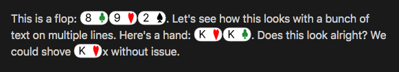

# Obsidian Poker

Easily document and view your poker hands.

## Screenshot



## How to Install

In Obsidian go to `Settings > Third-party plugins > Community Plugins > Browse` and search for `Poker`.

### Manual installation

Unzip the [latest release](https://github.com/mAAdhaTTah/obsidian-poker/releases/latest) into your `<vault>/.obsidian/plugins/` folder.

## How to Configure

The plugin allows you to customize the prefix you use for inline cards and range blocks. Go to `Settings -> Poker` to customize. The plugin defaults to `pkr` as the prefix.

## How to Use

### Rendering Cards

To render a card, add backticks your chosen prefix, and a colon, then write the card(s) in standard 2 letter notation, with a rank & suit pair. Ranks should be one of `AKQJT98765432X` (with X being rendered as `X` and meaning "any rank"); suits should be one of `dhscx` (with X being rendered as `x` and meaning "any suit").

#### Example

```
This is a card: `pkr:As`.

You can also do multiple cards at once: `pkr:AsAc`.
```

### Rendering Ranges

To render a hand range as a 13x13 matrix, use a fenced code block whose language is your prefix followed by `-range` (`pkr-range` by default) and put a range string in the body:

````
```pkr-range
AA,KK,QQ,JJ:0.75,TT:0.5,AKs,AQs:0.5,AKo
```
````

A range is a comma-separated list of combos (`AA`, `AKs`, `AKo`), shorthand runs (`22+`, `A2s+`, `TT-77`) or exact hands (`AhKh`), each optionally followed by `:frequency` between 0 and 1. Weighted combos render as partially filled cells. If the range can't be parsed, the block shows the parser's error instead of the matrix.

Click **Edit** on a rendered range to paint it:

- **Brush** paints cells at the weight set by the "In range" slider (100 = always in range). Click or drag across cells.
- **Eyedropper** picks up a cell's weight onto the brush.
- **Clear** empties the matrix.
- **Save** writes the range back into the code block; **Cancel** discards your changes.

Saving only rewrites the combos you painted. Everything else, including suit-specific hands like `AhKh:0.7`, is kept exactly as written. In live preview, the save is a single editor change you can undo. An empty `pkr-range` block is a quick way to start a new range.

If you change the prefix in settings, reload the plugin for range blocks to pick it up.

## Roadmap

- Add support for card with no suit (e.g. `Kx`)
- Add support for unknown suited or offsuit cards or other cards (e.g. `KsXo`, `KsXs`, or `KsX`)
- Add command to generate a random number of cards (e.g. to generate a random flop)
- Add a hand replayer using markdown codeblocks & YAML to define a hand and show a replayer in preview to watch it
